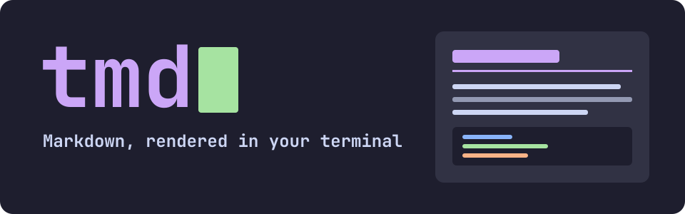
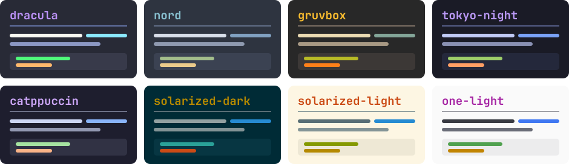
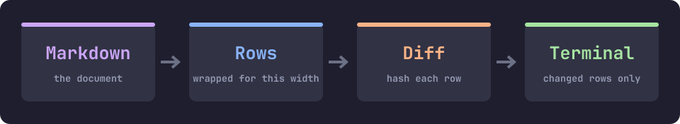

A tiny, fast Markdown viewer for the terminal.

```sh
tmd notes.md
```

Files open clean and read-only: symbols hidden, tables drawn as tables, links you can follow. It's the
terminal sibling of [mmd](https://github.com/jtnk/mmd), built on
[libghostty](https://github.com/ghostty-org/ghostty).

## What it looks like

This Markdown:

```markdown
# Pancakes

Whisk until **smooth**, rest for *ten minutes*, then fry in `butter`.

| Ingredient | Amount |
|------------|-------:|
| Flour      |   200g |
| Milk       |  300ml |

- [x] Eggs
- [ ] Lemon

> Flip once.
```

prints like this, straight from `tmd -p`:

```
Pancakes
━━━━━━━━━━━━━━━━━━━━━━━━━━━━━━━━━━━━━━━━━━━━━━━━━━━━━━━━━━━━

Whisk until smooth, rest for ten minutes, then fry in
butter.

┌────────────┬────────┐
│ Ingredient │ Amount │
├────────────┼────────┤
│ Flour      │   200g │
│ Milk       │  300ml │
└────────────┴────────┘

☑ Eggs
☐ Lemon

▌ Flip once.
```

That's the plain version for pipes. In a terminal you get color, a scrollbar and links you can follow,
and in terminals with graphics, large titles and images in place of the rule and alt text.

## What's in it

| | |
|---|---|
| **Large headings** | Terminals have one font size, so h1 and h2 are drawn as pixels, and scroll like text |
| **Images** | PNG, JPEG, GIF, BMP and SVG, in place in the document, over the kitty graphics protocol |
| **Tables that stay straight** | Widths come from Ghostty's own tables, so emoji and CJK can't push a border out |
| **Terminal output** | A block marked `ansi` keeps the colors of a pasted session, and nothing else gets through |
| **Tabs and links** | Links to Markdown open as tabs, with `#anchor` jumps; web pages and documents open outside tmd, and are marked `↗` |
| **Nine palettes** | Your terminal's own colors, or eight fixed themes, switched live with `t` |
| **Pages from the web** | Asks a site for Markdown the way agents do, instead of its HTML |
| **Safe with hostile files** | A document can't move your cursor, set your title or reach your clipboard |
| **Measured** | A live HUD, session reports, and a benchmark that fails when a frame misses 60 fps |



## Build

You need [Zig](https://ziglang.org/download/) 0.17 or later (Ghostty 1.4 requires it).

```sh
zig build --release=small                                    # zig-out/bin/tmd
zig build --release=small -Dtarget=x86_64-linux-musl         # a static Linux binary
zig build test                                               # all tests
```

Linux is the target. macOS works too, which is useful for development.

## Use

```sh
tmd notes.md              # view a file
tmd a.md b.md             # one tab each
tmd https://site.dev/docs # the Markdown behind a web page
tmd a.md https://site.dev/b.md  # files and URLs, in any mix
cat notes.md | tmd        # from a pipe
tmd -p notes.md           # print the rendered document (the default when stdout is a pipe)
```

Press **?** in tmd for every key. The essentials:

| Key | Action |
|---|---|
| `j` `k` `Space` `b` `g` `G` | Scroll |
| `Tab` `Enter` | Next link, follow it (or click) |
| `/` `n` `N` | Find |
| `o` | Open a file or URL in a new tab (`Tab` completes paths) |
| `` Ctrl+` `` or `[` `]` | Next tab (`Shift` for previous), or previous and next |
| `Ctrl+W` | Close tab (the last one quits), or click the `×` on a tab under the mouse |
| `t` | Next color palette |
| `F12` | Performance HUD |
| `F11` | Save the last 1,024 frames to a file, for a bug report |
| Drag | Select text and copy it |
| `Ctrl+Q` | Quit |

## Settings

`~/.config/tmd/config` (or under `$XDG_CONFIG_HOME`). Pressing `t` saves the palette here.

```
palette = nord          # system, dracula, nord, gruvbox, tokyo-night, catppuccin,
                        # solarized-dark, solarized-light, one-light
width = 100             # widest text column
images = on
big_headings = on
heading_font = /path/to/Bold.ttf
```

`system` uses your terminal's own colors. `TMD_IMAGES=off|direct|placeholder` overrides detection.

### Your own theme

Drop a file in `~/.config/tmd/themes/`. Name the colors you want to change, and the rest come from `base`:

```
# ~/.config/tmd/themes/mine.theme
base = nord
link = #ff79c6
heading = #ffb86c
```

Its file name is its name: `palette = mine`, `--palette mine`, or press `t` to reach it. The colors are
`bg`, `text`, `heading`, `muted`, `dim`, `link`, `code`, `code_bg` and `accent`, and `base` is any palette
but `system` (dracula if you leave it out). A file named after a built-in palette replaces it. If a theme
has a mistake, tmd says which line on the status row and leaves it out.

## How it draws



**Layout uses Ghostty's width tables.** tmd depends on `ghostty-vt`, the library inside Ghostty, as a
Zig module, so only what's used is linked. Grapheme widths come from Ghostty's own tables, which keeps
tables aligned around emoji, CJK and ZWJ sequences. Linking the whole emulator would cost about 830KB,
so the shipped binary doesn't: it uses the width tables and the SGR decoder, and the full `Terminal`
is linked into the tests only.

**Images use the kitty graphics protocol.** With Unicode placeholders an image is uploaded once and is
then ordinary cells in the grid, so it scrolls and clips like text. PNGs go to the terminal undecoded.
JPEG, GIF and BMP are decoded with stb_image and SVG with nanosvg. Images upload when first seen, and
off-screen ones are evicted to stay inside a memory budget (8MB in Rex, which limits each block).
Terminals with graphics but no placeholders get direct placements. Otherwise you see the alt text.

**Large headings are pixels.** Terminals have one font size, and the protocol that would change that
(OSC 66) is rendered only by kitty. So h1 and h2 are drawn with stb_truetype and shown as images, three
and two rows tall, wrapping as needed. A heading stays ordinary text when graphics are off, no font is
found, the font lacks a character, or it contains a link. Find still reaches them, and so does copying.

**`ansi` code blocks** keep the colors of pasted terminal output. Other sequences are dropped, and a
bare carriage return restarts the line the way a progress bar does.

**Frames are diffed.** Each row is built as bytes and hashed, only changed rows are sent, and a scroll
uses the terminal's own scroll. Frames use synchronized output, so they never tear.

**URLs go through `curl`.** tmd has no network code, which would cost more than the rest of the binary.
A URL is requested with `Accept: text/markdown`, and if a site still answers with HTML, tmd tries where
sites publish Markdown: `page.md`, then `page/index.html.md`. Only a URL you gave or a link you followed
is ever requested. Pages open read-only, and their relative links stay on the web, never on your disk.

**Documents can't reach the terminal.** Control characters are replaced before anything is written, so
a hostile file can't move the cursor, set the title or write to the clipboard. Nor can a link run
anything: a local file only opens if it's a known kind of document or picture, never a script or an app.

## Performance

`tmd --bench file.md` drives the real app through scrolling, jumping, resizing, typing and toggling,
and exits 1 if a scenario's p99 frame misses 60 fps. A 2MB document reaches its first frame in about
27ms, and on that file (Apple silicon, 120 x 40):

| Scenario | p50 ms | p99 ms | Best fps target met |
|---|--:|--:|--:|
| Scroll by line | 0.06 | 0.16 | 1000 |
| Scroll by page | 0.13 | 0.25 | 1000 |
| Jump top/bottom | 0.10 | 0.12 | 1000 |
| Cursor movement | 0.05 | 0.06 | 1000 |
| Resize | 16.2 | 17.7 | none |

Resizing lays the whole document out again. At 2MB the typical frame fits 60 fps and the slowest ones
just miss it, so this file still fails the benchmark, and it's the known gap. At 200KB it takes under
2ms. `perf/loops.md` records what was tried, including everything that didn't work.

`F12` adds three rows under the status line: frame times over the last 120 frames with a graph, the
frame rate, and what the last frame sent. `fps` is frames drawn in the last second, which is 0 at rest
because tmd only draws when something changes. `max` is the rate the recent p99 frame could sustain, and
`slow` counts recent frames that missed 60 fps. These measure tmd's own work: what reaches the screen
also depends on the terminal and the display. `TMD_TRACE=report.md` writes percentiles for a session.

tmd keeps its last 1,024 frames in memory, each with the time spent in input, layout, painting and
flushing, what set it off, and what it sent. If something stutters, press `F11` (or `Alt+L`) straight
away and attach the file it names to a bug report. It holds timings and sizes only: no file names, no
document text and no keys.

### Performance reviews

`perf/review.py` benchmarks tmd and has a small model explain the results:

```sh
perf/review.py --save-baseline    # record what good looks like
perf/review.py --dry-run          # compare against it, and print what the model would be given
perf/review.py                    # add the model's analysis (needs `pip install anthropic`)
```

It writes a Markdown report to `perf/reports/`, and exits 1 on a regression. The script does all the
arithmetic: medians over several runs, noise floors, the baseline comparison and the verdict. The model
(`claude-haiku-5-5`, or `--model`) only interprets, working from `perf/notes.md`. Every finding must
cite facts by id, the report prints the measured values beside it, and a finding that cites an unknown
fact or a number that isn't in the data is rejected.

## Tests

`zig build test` pushes tmd's real output through Ghostty's terminal emulator and asserts on the
emulator's state: random scrolling matches a full repaint, every row of the test pages is the width
the terminal says it is, hostile documents leave the terminal untouched, and images really land in its
image store.

`testdata/` is a quickstart and a test suite in one: mmd's linked pages, plus a gallery and an images
page. Start with `tmd testdata/quickstart.md`. `python3 testdata/perf/generate.py` makes the large
performance files, and `testdata/images/generate.py` redraws the artwork.

## Experimental: editing

The editor is in testing and off by default. `--experimental-edit` turns it on, or
`experimental_edit = on` in the config.

```sh
tmd --experimental-edit notes.md       # press e to edit, Esc to go back
tmd --experimental-edit -e new.md      # open straight in the editor
```

Editing happens in place, styled as you type, with the same text kept at the top of the view. It has
`Ctrl+S` save, `Ctrl+Z` / `Ctrl+Y` undo and redo, `Ctrl+B` / `Ctrl+I` / `Alt+C` to wrap the selection,
`Ctrl+K` link, `Ctrl+T` tidy, `Ctrl+F` / `Ctrl+G` find, and `Shift` + arrows to select. Saves are
atomic. `testdata/07-editing-playground.md` walks through it.

## Limitations

- Over tmux, images need `set -g allow-passthrough on`.
- The first view of a large JPEG blocks while it decodes. PNGs don't, as the terminal decodes them.
- Loading a URL waits for the page, and needs `curl`.
- Images in a page from the web aren't shown, and a document never makes a request by itself.
- Find matches within a row, so a phrase split across a line wrap isn't found.
- Copying uses the terminal's clipboard support (OSC 52), which some terminals leave off or ask about.
- Footnotes and raw HTML show as plain text.

## License

tmd is licensed under the [Apache License 2.0](LICENSE). The projects it builds on keep their own
licenses, which are listed in [THIRD_PARTY_NOTICES.md](THIRD_PARTY_NOTICES.md).
