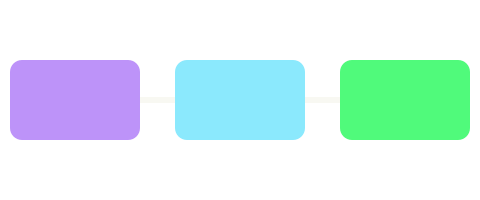

# Images and terminal output

[← Back to the index](quickstart.md)

A PNG, sent to the terminal undecoded:


An SVG, rasterized to fit:



A small BMP stays small:


A missing file shows its alt text:


An image in running text  stays as text.

## Terminal output

A fenced block marked `ansi` keeps its colors. Anything else in it, such as cursor movement or a
window title, is dropped, and a carriage return restarts the line the way a progress bar does.

```ansi
✓ build (1.2s)
✗ test warning: underlined
downloading  10%
downloading  50%
downloading 100%
]0;a window titlestill here
```
