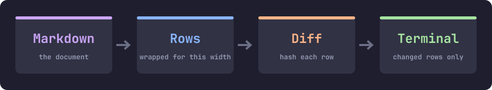
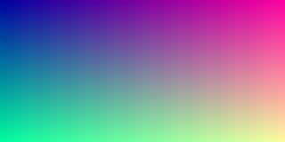
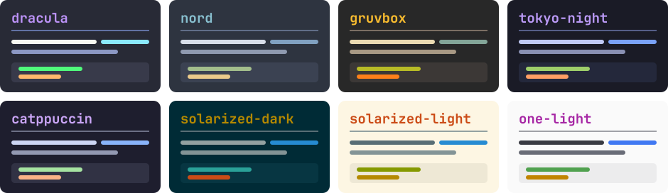

# Gallery

Everything tmd draws, on one page. Scroll with `j` and `k`, and press `t` to repaint it all in the
next palette. The title above isn't text: terminals have one font size, so it's drawn as pixels.

[← Back to the index](quickstart.md)


## Images in the document

Images sit in the grid as cells, so they scroll, clip and resize with the text around them. This SVG
is rasterized at exactly the size it's shown.



A PNG goes to the terminal as it is, without tmd decoding it:



## Every palette

Press `t` to walk through these. Your choice is saved, and `system` keeps your terminal's own colors.



## Terminal output, with its colors

Paste a session into a block marked `ansi` and it keeps its colors. Nothing else gets through: the
window title and screen clear in this block are dropped, and the upload line shows only its final
state, as a progress bar would.

```ansi
$ make release
✓ compile    412 files
✓ test       all passed
! lint       2 warnings in src/app.zig
✗ deploy     refused: friday maintenance window
upload  10%
upload  40%
upload  80%
upload 100% done
]0;a window title you will never seethis line tried to clear your screen

                                                                
                                                                
                                                                
```

## Tables that stay straight

Widths come from Ghostty's own tables, so the borders line up around emoji, CJK and joined sequences.

| Thing | Example | Cells | Aligned |
|:---|:---:|---:|:---:|
| Plain text | hello | 5 | ✅ |
| Chinese | 你好世界 | 8 | ✅ |
| Japanese | こんにちは | 10 | ✅ |
| Rocket | 🚀 | 2 | ✅ |
| Joined emoji | 👩‍💻 | 2 | ✅ |
| Flag | 🏳️‍🌈 | 2 | ✅ |
| Accent | café | 4 | ✅ |

Long cells wrap instead of pushing the table off the screen:

| Feature | How it works |
|---|---|
| Row diffing | Each row is built as bytes and hashed, and only the rows that changed are sent, so scrolling a large file writes almost nothing. |
| Safe by default | Control characters are replaced before they reach the terminal, so a hostile file can't move the cursor or touch your clipboard. |

## Text

Plain, **bold**, *italic*, ***both***, ~~struck out~~, `code`, and [a link](https://ghostty.org). Bare
URLs work too: https://github.com/ghostty-org/ghostty.

### A third-level heading

Headings one and two are large. The rest stay as text, in color.

> A quote keeps its bar.
>
> > And so does a quote inside it, with **bold** and `code` still working.

## Lists

1. Numbers keep counting
2. Through items that wrap, with the continuation lined up under the text as you'd expect it to be
3. And nesting:
   - Bullets change shape
     - At each level

- [x] Render Markdown in a terminal
- [x] Show real images
- [x] Make titles large
- [ ] Your next document

## Code

```zig
pub fn main() void {
    std.debug.print("*not italic*, **not bold**\n", .{});
}
```

---

Press `?` for every key, and `Ctrl+W` to close this tab.
