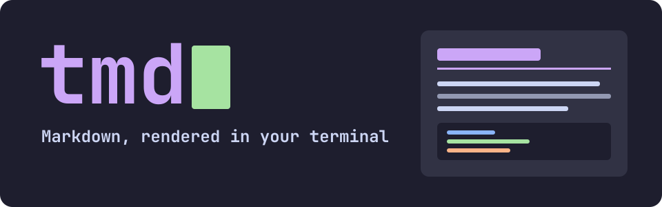

# tmd quickstart



You're reading this in tmd, or you should be: `tmd testdata/quickstart.md`. These pages show what
tmd can do and double as its test suite, so everything here is something tmd has to get right.

## Open something

```sh
tmd notes.md                           # a file
tmd a.md b.md                          # several files, one tab each
tmd https://bun.sh/docs/installation   # the Markdown behind a web page
tmd a.md https://site.dev/b.md         # files and URLs, in any mix
cat notes.md | tmd                     # from a pipe
tmd -p notes.md                        # print it and exit
```

Web pages are fetched as Markdown, the way agents ask for them, and their tabs are marked 🌐.

## Try these

1. Press `Tab` until a page in the table below is highlighted, then `Enter`. It opens in a new tab.
2. Press `o` and type a path or URL. `Tab` completes paths, and `Enter` opens it in a new tab.
3. Press `` Ctrl+` `` to move between tabs, and `Ctrl+W` to close one. With a mouse, hover over a tab
   and click its `×`.
4. Drag across some text to select and copy it.
5. Press `t` to repaint everything in the next palette. Your choice is saved.
6. Press `/` and type a word to find it, then `n` for the next match.
7. Press `F12` to watch frame times while you scroll. If something stutters, press `F11` to save the
   last 1,024 frames for a bug report.

Links marked `↗` open outside tmd. `?` lists every key, and `Ctrl+Q` quits.

## Make it yours

Settings live in `~/.config/tmd/config`, and your own palettes go in `~/.config/tmd/themes/`. Name the
colors you want to change, and the rest come from a built-in palette:

```
# ~/.config/tmd/themes/mine.theme
base = nord
link = #ff79c6
```

Then press `t` until you reach it, or set `palette = mine` in your config.

## Where to go

| # | Page | What it exercises |
|--:|---|---|
| ★ | [Gallery](09-gallery.md) | Everything at once: images, palettes, terminal output, tables |
| 1 | [Text and inline formatting](01-text.md) | Headings 1–6, bold, italic, code, links in running text, long paragraphs |
| 2 | [Tables](02-tables.md) | Narrow, wide and many-column tables; alignment; formatting and escaped pipes in cells |
| 3 | [Lists and quotes](03-lists-and-quotes.md) | Bullets, numbers, nesting, task lists, block quotes |
| 4 | [Code](04-code.md) | Fenced blocks (backticks and tildes), Markdown inside code, very long lines |
| 5 | [Links](05-links.md) | Relative, nested-folder, spaces in names, anchors, web, mail, missing files |
| 6 | [Edge cases](06-edge-cases.md) | Unicode, emoji, CJK, right-to-left, unclosed markers, unsupported syntax |
| 7 | [Editing playground](07-editing-playground.md) | Needs `--experimental-edit`. Step-by-step editor checks: fences, undo/redo, ⌘B/⌘I/⌘K, Tidy |
| 8 | [Images and terminal output](08-images-and-ansi.md) | PNG, SVG and BMP images, a missing image, `ansi` blocks |
| 9 | [Performance files](perf/README.md) | Generated 200KB and 2MB documents for scrolling, resizing and the benchmark |

---

## Checklist

What to look for on each page:

- [ ] Every page opens in preview with no Markdown symbols showing (except in code)
- [ ] Each table above and on page 2 draws as a table, with wrapped cells and a bold header
- [ ] Horizontal rules span the full text column
- [ ] List numbers and bullets are muted, not blue
- [ ] Following a page link opens a new tab; **Ctrl+W** closes it
- [ ] **t** restyles every open tab live
- [ ] Resizing the window keeps the top line in place, mid-document
- [ ] Page 8 shows images in kitty and Ghostty, and they scroll and clip like text
- [ ] The HUD's graph stays low while scrolling
